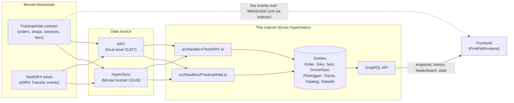
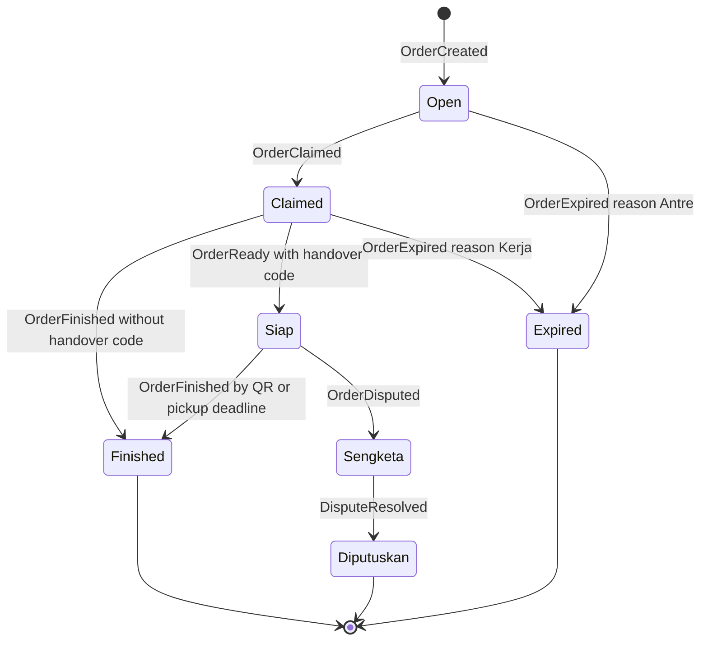
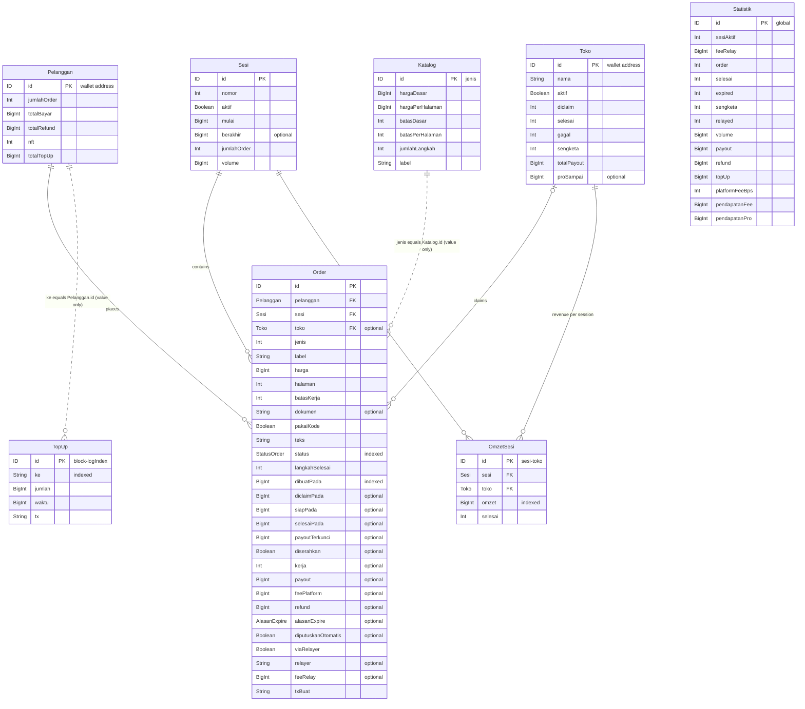

# PrintPitt · indexer

Envio HyperIndex 3.14 indexer for the **Fotokopi Kilat** game contracts (`FotokopiKilat` + `TestIDRX`) on Monad.

- [What this is, in plain words](#what-this-is-in-plain-words)
- [Why it exists](#why-it-exists)
- [How it works](#how-it-works)
- [Glossary (Indonesian names)](#glossary-indonesian-names)
- [Event to entity mapping](#event-to-entity-mapping)
- [Entity relationships](#entity-relationships)
- [Example GraphQL queries](#example-graphql-queries)
- [Setup and commands](#setup-and-commands)
- [Chains and addresses](#chains-and-addresses)
- [Where the ABIs come from](#where-the-abis-come-from)
- [Deploying to Envio Cloud (not done yet)](#deploying-to-envio-cloud-not-done-yet)
- [Repository map](#repository-map)

---

## What this is, in plain words

Fotokopi Kilat ("lightning photocopy") is an on-chain photocopy-shop game on Monad. Viewers place print orders and pay into an
escrow contract. Shops race to claim each order. The shop's payout drops every second it takes, the rest is refunded to the
customer, and the customer receives an NFT of the finished print.

Everything the game does is written to the blockchain as **events** ("order 12 was created", "shop A claimed order 12",
"order 12 finished, payout Rp4,000"). A blockchain is good at recording these events, but bad at answering questions like
"who earned the most in session 3?" or "show me every order this customer has ever made". Answering those directly from the
chain means re-reading thousands of blocks each time.

This repository solves that. It reads every event once, keeps a tidy, always-up-to-date summary in a database, and lets the
website ask questions about it.

Three terms used below:

| Term | Meaning |
|---|---|
| **Indexer** | A program that follows the blockchain, reads every relevant event, and stores the result in a database that is fast to search. Think of it as the index at the back of a book: the book (the chain) is the source of truth, the index makes it quick to find things. |
| **HyperSync** | Envio's fast data service for reading historical blockchain data. It is much faster than asking a normal RPC node block by block. It needs an API token (`ENVIO_API_TOKEN`). |
| **GraphQL** | A query language for APIs. The website sends one request that describes exactly which fields it wants (for example "shop name and revenue, sorted by revenue") and gets exactly that back as JSON. |

The contract stays the source of truth. The indexer only summarises what the contract already emitted.

## Why it exists

Live game events (orders appearing, shops claiming, payouts ticking) go **directly** from the RPC node to the frontend over
WebSocket. That path is the fastest and does not need the indexer.

The indexer covers everything the live stream cannot give cheaply:

| Need | Entity that answers it |
|---|---|
| **Snapshot** when the frontend first opens (current session, open orders, shop list) | `Sesi`, `Order`, `Toko`, `Statistik` |
| **Order history** (every order with its timestamps, payout, refund, dispute outcome) | `Order` |
| **Per-session leaderboard** (revenue per shop per session, same as the contract's `omzet` mapping) | `OmzetSesi` |
| **Customer profiles** (orders placed, total paid, total refunded, NFTs received, tIDRX top-ups) | `Pelanggan`, `TopUp` |
| **Revenue stats** (platform fee earned, Toko Pro subscription income, volume, payout, refund totals) | `Statistik`, `Toko.proSampai`, `Order.feePlatform` |
| **Catalog** of order types with prices and time limits | `Katalog` |

## How it works



Files:

| Path | Purpose |
|---|---|
| `config.yaml` | Which contracts, events, chains, addresses and start blocks to index. |
| `schema.graphql` | The entities (database tables) and their fields. Also becomes the GraphQL schema. |
| `src/handlers/FotokopiKilat.ts` | One handler per `FotokopiKilat` event. |
| `src/handlers/TestIDRX.ts` | Handler for tIDRX `Transfer` (only mints count, see below). |
| `test/indexer.test.ts` | Vitest tests that feed simulated events into the handlers. No Docker, no network. |
| `abis/` | Contract ABIs, generated by the contracts repo. Do not edit by hand. |
| `.env.example` | Environment variables you can set. |

Notes that apply to the whole indexer:

- **Amounts** are in the smallest tIDRX unit. tIDRX has 2 decimals, so **Rp1 = 100**. A field value of `500000` is Rp5,000.
- **Times** (`dibuatPada`, `mulai`, `proSampai`, and so on) are Unix timestamps in seconds. Durations (`kerja`, `batasKerja`,
  `batasDasar`) are in seconds.
- **Per-chain data:** `disable_default_cross_chain: true` is set, so the same `id` on chain 10143 and chain 31337 are two
  different rows (for example each chain has its own `Statistik` row with id `global`).
- **IDs:** `Order.id` is the on-chain order id as a string, `Sesi.id` is the session number as a string, `Toko.id` and
  `Pelanggan.id` are wallet addresses, `Katalog.id` is the order type number (`jenis`), `OmzetSesi.id` is `"<sesi>-<toko>"`,
  and `TopUp.id` is `"<blockNumber>-<logIndex>"`.
- Only the transaction `hash` is requested from the chain (`field_selection`), used for explorer links (`Order.txBuat`, `TopUp.tx`).

## Glossary (Indonesian names)

Entity and field names are Indonesian, matching the contract. This table translates every one of them.

### Entities and enums

| Name | English meaning |
|---|---|
| `Order` | A print order placed by a customer |
| `Toko` | Shop (a player that claims and completes orders) |
| `Sesi` | Game session (a round of play) |
| `OmzetSesi` | Session revenue: one shop's revenue in one session (leaderboard row) |
| `Pelanggan` | Customer (the wallet that places orders) |
| `TopUp` | A tIDRX top-up (token mint to a wallet) |
| `Katalog` | Catalog entry: one order type with its pricing and time limits |
| `Statistik` | Global statistics (one row per chain, id `global`) |
| `StatusOrder` | Order status enum |
| `AlasanExpire` | Expiry reason enum |

### `StatusOrder` values

| Value | English meaning |
|---|---|
| `Open` | Waiting for a shop to claim it |
| `Claimed` | A shop claimed it and is working on it |
| `Siap` | Ready: work done, payout locked, waiting for QR handover |
| `Finished` | Finished and paid out |
| `Expired` | Expired, customer refunded |
| `Sengketa` | Disputed by the customer |
| `Diputuskan` | Dispute resolved (decided) |

### `AlasanExpire` values

| Value | English meaning |
|---|---|
| `Antre` | Queue: no shop claimed the order in time |
| `Kerja` | Work: a shop claimed it but did not finish within the work time limit |

### `Order` fields

| Field | English meaning |
|---|---|
| `id` | Order id from the contract |
| `pelanggan` | Customer who placed the order (link to `Pelanggan`) |
| `jenis` | Order type number (matches `Katalog.id`) |
| `label` | Order type label, copied from `Katalog.label` at creation (for example "FOTOKOPI KTP") |
| `harga` | Price paid into escrow |
| `halaman` | Number of pages |
| `batasKerja` | Work time limit in seconds |
| `dokumen` | Hash of the encrypted document; empty means demo mode without a document |
| `pakaiKode` | Uses a code: order needs a QR handover (`kodeHash != 0`) |
| `teks` | Text the customer entered for the print |
| `status` | Current `StatusOrder` |
| `sesi` | Session the order belongs to (link to `Sesi`) |
| `toko` | Shop that claimed it (link to `Toko`, empty while `Open`) |
| `langkahSelesai` | Number of work steps completed |
| `dibuatPada` | Created at |
| `diclaimPada` | Claimed at |
| `siapPada` | Ready at |
| `selesaiPada` | Closed at (finished, expired or dispute decided; block timestamp) |
| `payoutTerkunci` | Payout locked when the order became `Siap` |
| `diserahkan` | Handed over: `true` = handed over by QR or no code needed; `false` = closed after the pickup deadline |
| `kerja` | Work time in seconds |
| `payout` | Net payout to the shop (after platform fee) |
| `feePlatform` | Platform fee taken from this order |
| `refund` | Amount refunded to the customer |
| `alasanExpire` | Expiry reason (`AlasanExpire`) |
| `diputuskanOtomatis` | Decided automatically: the dispute was closed 50/50 because the operator did not decide before the deadline |
| `viaRelayer` | Order was submitted through a gas relayer |
| `relayer` | Relayer address |
| `feeRelay` | Relay fee paid by the customer |
| `txBuat` | Transaction hash of the order creation |

### `Toko` fields

| Field | English meaning |
|---|---|
| `id` | Shop wallet address |
| `nama` | Shop name |
| `aktif` | Active: `false` if the operator deactivated the shop (it cannot claim) |
| `orders` | Orders this shop claimed (derived) |
| `diclaim` | Number of orders claimed |
| `selesai` | Number of orders finished |
| `gagal` | Number of failures (claimed, then expired past the work time limit) |
| `sengketa` | Number of disputes against this shop |
| `totalPayout` | Total payout received |
| `proSampai` | Toko Pro (paid shop subscription) active until (seconds); empty = never subscribed |

### `Sesi` fields

| Field | English meaning |
|---|---|
| `id` | Session number as a string |
| `nomor` | Session number |
| `aktif` | Session is running |
| `mulai` | Start time |
| `berakhir` | End time |
| `orders` | Orders in this session (derived) |
| `omzet` | Leaderboard rows for this session (derived `OmzetSesi`) |
| `jumlahOrder` | Number of orders |
| `volume` | Total order value (sum of `harga`) |

### `OmzetSesi` fields

| Field | English meaning |
|---|---|
| `id` | `"<sesi>-<toko>"` |
| `sesi` | Session (link to `Sesi`) |
| `toko` | Shop (link to `Toko`) |
| `omzet` | Revenue: sum of the shop's payouts in this session |
| `selesai` | Number of orders finished in this session |

### `Pelanggan` fields

| Field | English meaning |
|---|---|
| `id` | Customer wallet address |
| `orders` | Orders placed (derived) |
| `jumlahOrder` | Number of orders |
| `totalBayar` | Total paid (order prices plus relay fees) |
| `totalRefund` | Total refunded |
| `nft` | Number of print NFTs received (one per finished order) |
| `totalTopUp` | Total tIDRX topped up (minted) to this wallet |

### `TopUp` fields

| Field | English meaning |
|---|---|
| `id` | `"<blockNumber>-<logIndex>"` |
| `ke` | To: receiving wallet |
| `jumlah` | Amount |
| `waktu` | Time |
| `tx` | Transaction hash |

### `Katalog` fields

| Field | English meaning |
|---|---|
| `id` | Order type number (`jenis`) |
| `hargaDasar` | Base price |
| `hargaPerHalaman` | Price per page |
| `batasDasar` | Base work time limit (seconds) |
| `batasPerHalaman` | Extra work time per page (seconds) |
| `jumlahLangkah` | Number of work steps |
| `label` | Display label |

### `Statistik` fields

| Field | English meaning |
|---|---|
| `id` | Always `global` |
| `sesiAktif` | Number of the active session; `0` = no session running |
| `feeRelay` | Current relay fee setting (not a running total) |
| `order` | Orders created |
| `selesai` | Orders finished |
| `expired` | Orders expired |
| `sengketa` | Orders disputed |
| `relayed` | Orders submitted through a relayer |
| `volume` | Total order value |
| `payout` | Total payout to shops |
| `refund` | Total refunds to customers |
| `topUp` | Total tIDRX minted as top-ups |
| `platformFeeBps` | Platform fee in basis points (300 = 3%) |
| `pendapatanFee` | Platform fee revenue |
| `pendapatanPro` | Toko Pro subscription revenue |

## Event to entity mapping

Every event listed in `config.yaml`, and what its handler changes.

| Contract | Event | Entities and fields changed |
|---|---|---|
| FotokopiKilat | `KatalogSet` | `Katalog` (id = `jenis`): set `hargaDasar`, `hargaPerHalaman`, `batasDasar`, `batasPerHalaman`, `jumlahLangkah`, `label`. |
| FotokopiKilat | `ShopRegistered` | `Toko` created: `nama`, `aktif = true`, counters 0, `totalPayout = 0`. |
| FotokopiKilat | `ShopRenamed` | `Toko.nama` (only if the shop exists). |
| FotokopiKilat | `ShopStatusSet` | `Toko.aktif` (only if the shop exists). |
| FotokopiKilat | `SessionStarted` | `Sesi` created: `nomor`, `aktif = true`, `mulai`. `Statistik.sesiAktif` = session number. |
| FotokopiKilat | `SessionEnded` | `Sesi.aktif = false`, `Sesi.berakhir`. `Statistik.sesiAktif = 0`. |
| FotokopiKilat | `FeeRelaySet` | `Statistik.feeRelay`. |
| FotokopiKilat | `PlatformSet` | `Statistik.platformFeeBps` (the `treasury` and `hargaPro` params are not stored). |
| FotokopiKilat | `PlatformFeeTaken` | `Order.feePlatform`; `Statistik.pendapatanFee += fee`. |
| FotokopiKilat | `ProSubscribed` | `Toko.proSampai`; `Statistik.pendapatanPro += bayar`. |
| FotokopiKilat | `OrderCreated` | `Order` created with `status = Open`, `sesi` = `Statistik.sesiAktif`, `label` from `Katalog`, `txBuat`. `Pelanggan` created if new: `jumlahOrder += 1`, `totalBayar += harga`. `Sesi.jumlahOrder += 1`, `Sesi.volume += harga`. `Statistik.order += 1`, `Statistik.volume += harga`. |
| FotokopiKilat | `OrderDetail` | `Order.halaman`, `Order.batasKerja`, `Order.dokumen` (empty if zero hash), `Order.pakaiKode` (`kodeHash != 0`). |
| FotokopiKilat | `OrderRelayed` | `Order.viaRelayer = true`, `Order.relayer`, `Order.feeRelay`. `Pelanggan.totalBayar += fee`. `Statistik.relayed += 1`. |
| FotokopiKilat | `OrderClaimed` | `Order.status = Claimed`, `Order.toko`, `Order.diclaimPada`. `Toko.diclaim += 1`. |
| FotokopiKilat | `StepCompleted` | `Order.langkahSelesai` = `urutan`. |
| FotokopiKilat | `OrderReady` | `Order.status = Siap`, `Order.siapPada`, `Order.kerja`, `Order.payoutTerkunci`. |
| FotokopiKilat | `OrderFinished` | `Order.status = Finished`, `selesaiPada`, `kerja`, `payout`, `refund`, `diserahkan`. `Toko.selesai += 1`, `Toko.totalPayout += payout`. `OmzetSesi` (created if new): `omzet += payout`, `selesai += 1`. `Pelanggan.totalRefund += refund`, `Pelanggan.nft += 1`. `Statistik.selesai += 1`, `payout += payout`, `refund += refund`. |
| FotokopiKilat | `OrderExpired` | `Order.status = Expired`, `selesaiPada`, `refund`, `alasanExpire`. `Pelanggan.totalRefund += refund`. `Statistik.expired += 1`, `Statistik.refund += refund`. If reason is `Kerja` and a shop had claimed it: `Toko.gagal += 1`. |
| FotokopiKilat | `OrderDisputed` | `Order.status = Sengketa`. `Statistik.sengketa += 1`. `Toko.sengketa += 1` for the claiming shop. |
| FotokopiKilat | `DisputeResolved` | `Order.status = Diputuskan`, `selesaiPada`, `payout`, `refund`, `diputuskanOtomatis`. `Toko.totalPayout += payout`. `OmzetSesi.omzet += payout` (not `selesai`). `Pelanggan.totalRefund += refund` (no NFT). `Statistik.payout += payout`, `Statistik.refund += refund`. |
| TestIDRX | `Transfer` | Only mints (`from` = zero address) count; normal transfers are ignored. `TopUp` created (`ke`, `jumlah`, `waktu`, `tx`). `Pelanggan` created if new: `totalTopUp += value`. `Statistik.topUp += value`. |

Order lifecycle, as reflected in `Order.status`:



The handlers simply set the status each event names; the allowed transitions are enforced by the contract. The diagram shows
the paths exercised by `test/indexer.test.ts`.

## Entity relationships



Dotted lines are not database links: `Order.jenis` and `TopUp.ke` hold plain values that happen to match `Katalog.id` and
`Pelanggan.id`. `Statistik` stands alone.

## Example GraphQL queries

With `npm run dev` the GraphQL endpoint runs locally at `http://localhost:8080`. Link fields are filtered through their
`_id` column (`sesi_id`, `toko_id`, `pelanggan_id`). Addresses are stored as the indexer receives them from the chain
(checksummed, mixed case), so pass them in that form.

**Leaderboard for one session** (`$sesi` is the session number as a string, for example `"1"`):

```graphql
query Leaderboard($sesi: String!) {
  OmzetSesi(where: { sesi_id: { _eq: $sesi } }, order_by: { omzet: desc }) {
    toko { id nama proSampai }
    omzet
    selesai
  }
  Sesi(where: { id: { _eq: $sesi } }) { nomor aktif mulai berakhir jumlahOrder volume }
}
```

**Open orders** (waiting for a shop, being worked on, or ready for handover):

```graphql
query OpenOrders {
  Order(
    where: { status: { _in: ["Open", "Claimed", "Siap"] } }
    order_by: { dibuatPada: asc }
  ) {
    id label teks harga halaman batasKerja status pakaiKode
    toko_id dibuatPada diclaimPada siapPada
  }
}
```

**One customer's history** (profile, orders, top-ups):

```graphql
query CustomerHistory($pelanggan: String!) {
  Pelanggan(where: { id: { _eq: $pelanggan } }) {
    jumlahOrder totalBayar totalRefund nft totalTopUp
  }
  Order(where: { pelanggan_id: { _eq: $pelanggan } }, order_by: { dibuatPada: desc }) {
    id label teks harga status toko { nama }
    payout feePlatform refund alasanExpire diserahkan diputuskanOtomatis
    viaRelayer feeRelay dibuatPada selesaiPada txBuat
  }
  TopUp(where: { ke: { _eq: $pelanggan } }, order_by: { waktu: desc }) {
    jumlah waktu tx
  }
}
```

**Revenue stats** (platform fee, Toko Pro, totals):

```graphql
query RevenueStats {
  Statistik(where: { id: { _eq: "global" } }) {
    platformFeeBps pendapatanFee pendapatanPro
    order selesai expired sengketa relayed
    volume payout refund topUp sesiAktif feeRelay
  }
  Toko(where: { proSampai: { _is_null: false } }, order_by: { proSampai: desc }) {
    id nama proSampai totalPayout
  }
}
```

Remember to divide amounts by 100 to show rupiah.

## Setup and commands

Requirements: Node `>= 22.15.0` (see `package.json`). Docker is needed only for `npm run dev` / `npm start`
(OrbStack works on macOS).

```bash
npm install
npm run codegen     # required after clone, and after every change to config.yaml or schema.graphql
npm run typecheck   # tsc --noEmit
npm test            # vitest with simulated events: no Docker, no network
npm run dev         # local indexer + GraphQL at http://localhost:8080; needs Docker
```

- `npm run codegen` generates `.envio/types.d.ts` (not committed). `envio-env.d.ts` points at it, so typecheck and tests fail
  until codegen has run.
- `npm test` runs `test/indexer.test.ts` on chain 31337 with simulated events: a full session (top-up, relayed order that
  finishes, queue expiry, work expiry), the v2 document and QR handover flow with a dispute, v2.1 platform fee and Toko Pro,
  and v2.3 shop rename and deactivation.
- `npm run dev` indexes **both** configured chains. Monad testnet uses HyperSync and needs `ENVIO_API_TOKEN`. Chain 31337
  needs a local anvil node at `ENVIO_ANVIL_RPC` (see the backend repo's `test/uji-anvil.sh`).
- `npm start` (`envio start`) also exists for running without the dev tooling.

### Environment variables

Copy `.env.example` to `.env` and fill in what you need. Never commit `.env`; it is in `.gitignore`.

| Variable | Default (from `config.yaml`) | Purpose |
|---|---|---|
| `ENVIO_API_TOKEN` | none | HyperSync token for Monad testnet. Get one at https://envio.dev/app/api-tokens. Set it in `.env` or in Envio Cloud. |
| `ENVIO_FK_ADDRESS` | `0x24b045E3B4155232F81c709dF3DD43595a5C5101` | `FotokopiKilat` address on chain 10143. Set only after a redeploy. |
| `ENVIO_TIDRX_ADDRESS` | `0xcCf26C3b02a610fB87327f41a13384aF8ff57F45` | `TestIDRX` address on chain 10143. Set only after a redeploy. |
| `ENVIO_START_BLOCK` | `73752547` | Block to start indexing chain 10143 from. Set it to the new deploy block after a redeploy. |
| `ENVIO_ANVIL_RPC` | `http://127.0.0.1:8545` | RPC URL of the local anvil node (chain 31337). |

Leave the address and start block variables empty to use the testnet deployment in `config.yaml`. After a redeploy, take the
new values from `deployments/10143.json` in [`PrintPitt/contracts`](https://github.com/PrintPitt/contracts).

If `start_block` is set later than an order's creation, handlers for that order log
`Order #<id> belum terindeks (start_block terlalu tinggi?)` ("not indexed yet, start_block too high?") and skip the update.

## Chains and addresses

| Chain | Chain ID | Source | `FotokopiKilat` | `TestIDRX` (tIDRX) | Start block | Status |
|---|---|---|---|---|---|---|
| Monad testnet | 10143 | HyperSync (`https://10143.hypersync.xyz`) | `0x24b045E3B4155232F81c709dF3DD43595a5C5101` (v2.3) | `0xcCf26C3b02a610fB87327f41a13384aF8ff57F45` | `73752547` | Configured (default, deploy of 2026-10-24) |
| Local anvil | 31337 | RPC (`ENVIO_ANVIL_RPC`) | `0x9fE46736679d2D9a65F0992F2272dE9f3c7fa6e0` | `0x5FbDB2315678afecb367f032d93F642f64180aa3` | `0` | Configured (deterministic addresses: anvil key #0, nonces 0 and 1) |
| Monad mainnet | 143 | to be checked | `0x4b453b395eEa830C5CB208551A0326f6cd976f12` | `0xEf3369C083B137C0FB3Fa9424990726d424ac205` | to be confirmed | **Not configured yet** (target) |

The testnet addresses can be overridden with the env vars above. The anvil addresses are fixed in `config.yaml`.

### Adding Monad mainnet (143)

Mainnet is the target but is not in `config.yaml` yet. To add it:

1. **Check HyperSync availability** for chain 143 in Envio's supported-networks list. If HyperSync covers it, no `rpc` block
   is needed (same as 10143). If not, add an `rpc` entry with `for: sync` pointing at a Monad mainnet RPC.
2. **Find the deploy block.** `deployments/143.json` in the contracts repo has the addresses but no block number. Run
   `node script/export.mjs` in the contracts repo, which prints `deployBlock` per chain, or read the receipts in
   `broadcast/Deploy.s.sol/143/run-latest.json`. For the active mainnet deployment (v2.3 + tIDRX) `export.mjs` reports `deployBlock` **116137717**.
3. **Add a chain entry** to `config.yaml`, following the 10143 pattern:

   ```yaml
     - id: 143
       start_block: ${ENVIO_MAINNET_START_BLOCK:-<deploy block>}
       contracts:
         - name: FotokopiKilat
           address: "${ENVIO_MAINNET_FK_ADDRESS:-0x4b453b395eEa830C5CB208551A0326f6cd976f12}"
         - name: TestIDRX
           address: "${ENVIO_MAINNET_TIDRX_ADDRESS:-0xEf3369C083B137C0FB3Fa9424990726d424ac205}"
   ```

   The env var names above are suggestions; add any new ones to `.env.example`.
4. Run `npm run codegen`, `npm run typecheck` and `npm test`, then `npm run dev` to check that mainnet events arrive.

## Where the ABIs come from

`abis/FotokopiKilat.json` and `abis/TestIDRX.json` are written by `script/export.mjs` in
[`PrintPitt/contracts`](https://github.com/PrintPitt/contracts). The script writes them only when this repo is cloned next to
the contracts repo (it looks for `../indexer/config.yaml`).

**Do not edit them by hand.** After the contracts change:

```bash
# in the contracts repo, with this repo cloned at ../indexer
forge build
node script/export.mjs
# back in this repo
npm run codegen && npm run typecheck && npm test
```

If a new contract version adds or changes events, update `config.yaml`, `schema.graphql` and `src/handlers/` to match.

## Deploying to Envio Cloud (not done yet)

The indexer has **not** been deployed to Envio Cloud. Outline of the planned steps:

1. Connect the `PrintPitt/indexer` GitHub repo in the Envio hosted service and choose the branch to deploy.
2. Set environment variables there: `ENVIO_API_TOKEN`, and the `ENVIO_FK_ADDRESS` / `ENVIO_TIDRX_ADDRESS` /
   `ENVIO_START_BLOCK` overrides if they differ from the defaults. Never put the token in the repo.
3. Decide what to do with chain 31337: a hosted indexer cannot reach a local anvil RPC, so that chain entry has to be removed
   or split into a separate config for the cloud deployment.
4. Add the mainnet chain entry once it is ready (see above).
5. Deploy, wait for the indexer to sync, and point the frontend at the hosted GraphQL endpoint.

## Repository map

| Repository | What it holds |
|---|---|
| [`PrintPitt/contracts`](https://github.com/PrintPitt/contracts) | `FotokopiKilat` and `TestIDRX` contracts (Foundry), deploy script, `deployments/<chainId>.json`, and `script/export.mjs` that writes this repo's `abis/`. |
| [`PrintPitt/backend`](https://github.com/PrintPitt/backend) | Node service: faucet, keeper (auto expiry), order bot, status endpoint; `test/uji-anvil.sh` for the local anvil setup. |
| [`PrintPitt/frontend`](https://github.com/PrintPitt/frontend) | The game website. Reads live events over WebSocket and snapshots, history and stats from this indexer's GraphQL API. |
| [`PrintPitt/indexer`](https://github.com/PrintPitt/indexer) | This repo. |
